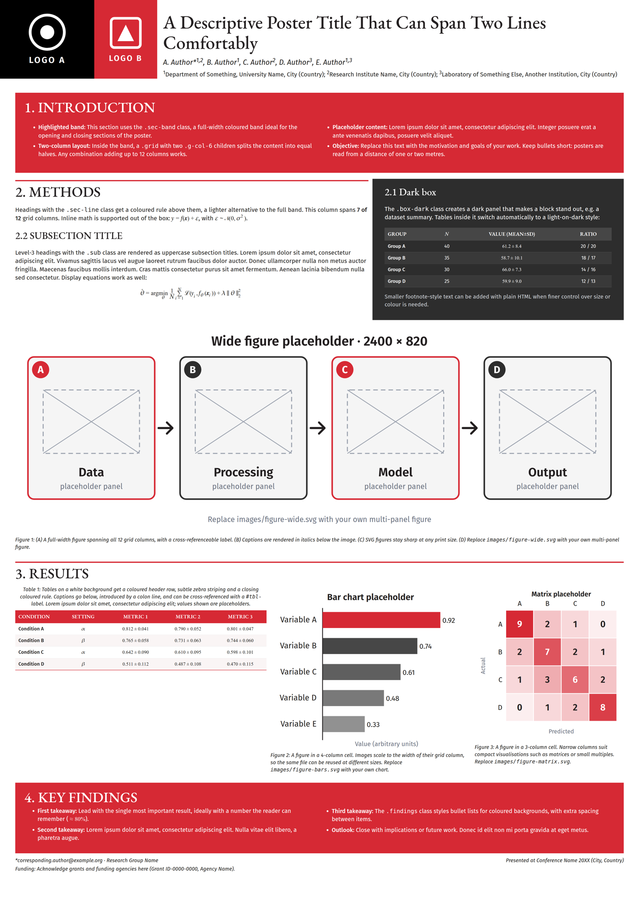

# Quarto Poster

A [Quarto](https://quarto.org) extension for **A0 portrait conference posters** written in plain Markdown and rendered to a single self-contained HTML file, ready to print to PDF.



## Features

- **A0 portrait page** (841 × 1189 mm) with print styles for PDF export.
- **Header from YAML**: title, authors with numbered affiliations, and coloured logo panels.
- **12-column grid** (`.grid` + `.g-col-1` … `.g-col-12`) for free-form layouts.
- **Section styles**: full coloured bands (`.sec-band`) and headings with a top rule (`.sec-line`).
- **Dark highlight box** (`.box-dark`) whose tables switch automatically to light-on-dark.
- **Styled tables and figures** with captions and cross-references (`#fig-…`, `#tbl-…`).
- **Native math** via MathML: no JavaScript, works offline.
- **Self-hosted fonts** (Fira Sans + EB Garamond) embedded in the output: no network needed.

## Installation

Start a new poster from the template:

```bash
quarto use template <github-user>/<repo>
```

Or add the format to an existing project:

```bash
quarto add <github-user>/<repo>
```

## Usage

Set the format in your document's YAML header:

```yaml
format: poster-html
```

Then render it:

```bash
quarto render poster.qmd
```

Open the HTML in a Chromium-based browser and print it to PDF (paper size is set to A0 by the CSS, margins *None*, background graphics *on*).

### Header

```yaml
title: "Poster title"
authors:
  - name: "A. Author*"
    affiliation:
      - ref: inst-a
affiliations:
  - id: inst-a
    name: University Name
    department: Department of Something   # optional
    city: City
    country: Country
poster-logos:
  - path: "images/logo-a.svg"
    panel-class: "bg-black"   # or "bg-red"
```

### Layout components

| Class | Use |
|:--|:--|
| `.poster` | Wraps the whole poster body. |
| `.grid` / `.g-col-N` | 12-column grid; children span `N` columns. |
| `.sec-band` | Full-width coloured band for a section. |
| `.sec-line` | Section heading with a coloured top rule. |
| `.sub` | Uppercase subsection heading (on `###`). |
| `.box-dark` | Dark highlight box. |
| `.findings` | Bullet-list styling for coloured backgrounds. |
| `.poster-footer` | Footer line(s). |

See [`template.qmd`](template.qmd) for a complete example using every component.

### Theming

Override the CSS variables in a stylesheet of your own:

```yaml
format:
  poster-html:
    css: custom.css
```

```css
:root {
  --red: #1f6feb;   /* accent colour */
  --dark: #1e293b;  /* dark box */
  --ink: #111827;   /* text */
}
```

## License

Code: MIT (see [LICENSE](LICENSE)). The bundled fonts, Fira Sans and EB Garamond, are distributed under the [SIL Open Font License 1.1](https://openfontlicense.org).
