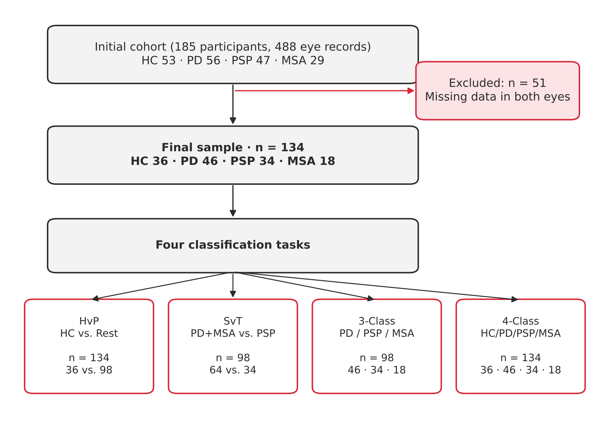
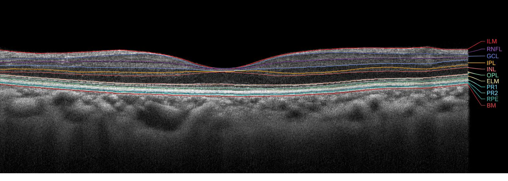

::: {.poster}

::: {.sec-band}
## 1. Introduction

::: {.grid}

::: {.g-col-6}
- **Clinical Challenge:** Parkinson's disease (PD), progressive supranuclear palsy (PSP), and multiple system atrophy (MSA) share overlapping clinical presentations in early stages, making differential diagnosis challenging.

- **Underlying Proteinopathies:** PD and MSA are characterized by alpha-synuclein aggregation (**synucleinopathies**), whereas PSP involves pathological tau deposition (**tauopathy**).
:::

::: {.g-col-6}
- **The Retina as a Window to the CNS:** Optical coherence tomography (OCT) enables precise, non-invasive quantification of individual retinal layers, reflecting pathology-specific thinning patterns.

- **Objective:** We present a systematic machine learning evaluation using **XGBoost** across four classification tasks to distinguish healthy controls, proteinopathic groups, and clinical subtypes from OCT retinal morphometry.
:::

:::
:::

::: {.grid}
::: {.g-col-7}
## 2. Methodology {.sec-line}

Macular records were acquired and segmented using the **Heidelberg Spectralis OCT** device. Last higher-quality visits per patient were included, averaging both eyes to represent bilateral neurodegenerative involvement. A total of **29 morphometric features** were extracted, normalized at the subject level by total macular volume ($\text{TMV}+Z$), and standardized ($Z\text{-score}$).

### 2.2 CLASSIFICATION FRAMEWORK (XGBOOST) {.sub}

Classification was conducted using the **eXtreme Gradient Boosting (XGBoost)** algorithm , trained on the 29 morphometric features plus derived features (ratios between adjacent retinal layers and global-vs-sector differences). Four tasks of increasing difficulty were addressed: HC vs. rest, PD+MSA vs. PSP, PD/PSP/MSA, and the four classes simultaneously. Performance was evaluated via repeated 5-fold stratified cross-validation ($10 \times 5\text{-fold}$ CV), which preserves class proportions in every fold and reduces the variance of the estimate on a small cohort. Eye averaging and TMV normalization were applied before the data split, while feature scaling was fitted only on the training data of each fold to prevent information leakage. Models were compared using accuracy, balanced accuracy (main selection metric, robust to class imbalance) and macro-averaged F1. Feature relevance was assessed with XGBoost gain and SHAP values.

:::

::: {.g-col-5}

::: {.box-dark}
### 2.1 DATASET AND PARTICIPANTS {.ugr-subtitle .text-white .mb-3}

From 488 initial records (186 participants), individuals with low-quality estimations or missing values were discarded, resulting in **134 subjects**:

| Group | $N$ | Age (mean±SD) | M/F |
|:---|:---:|:---:|:---:|
| **HC** | 36 | $63.6 \pm 9.9$ | 20 / 33 |
| **PD** | 46 | $59.5 \pm 13.0$ | 29 / 19 |
| **PSP** | 34 | $70.4 \pm 7.5$ | 20 / 17 |
| **MSA** | 18 | $59.0 \pm 7.6$ | 20 / 9 |

Nine macular layers were segmented (RNFL, GCL, IPL, INL, OPL, ONL, RPE), alongside inner/outer retinal layer aggregates (IRL, ORL), total macular volume (TMV), ETDRS grid ring zones, and the RNFL-to-NT ratio.

:::

<!-- {#fig-sample-and-tasks width="80%"} -->

<!-- {#fig-oct-segment} -->

:::

::: {.g-col-12}

![(A) Cohort (n = 134 after exclusions) and the four classification tasks. (B) Macular retinal layers and their main cell types (schematic, not to scale). (C) ETDRS grid with nine macular sectors (right eye) and the HEYEX subfield labels (layer + numeric suffix). (D) Preprocessing pipeline: eye averaging and normalization (Z or TMV + Z), ratio-based feature engineering and PCA (95% variance), applied before the train/test split. HC: healthy controls; PD: Parkinson’s disease; PSP: progressive supranuclear palsy; MSA: multiple system atrophy; TMV: total macular volume.](images/fig_heyex_v5.svg){#fig-oct-segment width="100%"}

:::

:::

::: {.sec-line}
## 3. Results
:::

::: {.grid}

::: {.g-col-5}

| TASK | NORM. | ACCURACY | BAL. ACC. | F1-MACRO |
|:---|:---:|:---:|:---:|:---:|
| **HvP** (HC vs. Rest) | $Z$ |  **$0.724 \pm 0.079$** | $0.609 \pm 0.064$ | $0.619 \pm 0.073$ |
| **SvT** (PD+MSA vs. PSP) | $\text{TMV}+Z$ |  **$0.704 \pm 0.057$** | $0.650 \pm 0.071$ | $0.652 \pm 0.071$ |
| **3-Class** (PD/PSP/MSA) | $\text{TMV}+Z$ |  **$0.521 \pm 0.100$** | $0.472 \pm 0.105$ | $0.440 \pm 0.111$ |
| **4-Class** (HC/PD/PSP/MSA) | $Z$ |  **$0.395 \pm 0.120$** | $0.374 \pm 0.110$ | $0.354 \pm 0.112$ |

: Classification performance of XGBoost for each task, reported as mean ± standard deviation across folds of repeated stratified 5-fold cross-validation (10 × 5-fold CV). Balanced accuracy, the main selection metric, is the mean per-class sensitivity, so every class has equal weight regardless of its size. F1-macro is the unweighted mean of the per-class F1 scores. Chance-level balanced accuracy is 0.50 for the binary tasks, 0.33 for the 3-class task and 0.25 for the 4-class task. NORM. indicates the normalization used: Z = standardization (Z-score) only; TMV + Z = normalization by total macular volume followed by Z-score. HvP: healthy controls vs. rest; SvT: synucleinopathies (PD+MSA) vs. tauopathy (PSP); 3-class: PD/PSP/MSA; 4-class: HC/PD/PSP/MSA. {#tbl-results}

:::

::: {.g-col-4}

{#fig-gain-top5 width="100%"}

:::

::: {.g-col-3}

{#fig-confusion-matrix width="100%"}

:::

:::

::: {.sec-band}
## 4. Key findings

::: {.grid .findings}
::: {.g-col-6}
* **Robust Biological Stratification ($\approx 70\%$):** The XGBoost framework effectively distinguishes synucleinopathies (PD+MSA) from tauopathies (PSP) ($0.704 \pm 0.057$), comparable to binary HC vs. pathology discrimination ($0.724 \pm 0.079$).
* **Divergent Retinal Signatures:** Findings confirm that alpha-synuclein and tau pathology exert divergent neurodegenerative pressures on inner and outer retinal architecture.
:::
::: {.g-col-6}
* **Multiclass Phenotypic Overlap:** Performance in 3-class ($0.521$) and 4-class ($0.395$) settings highlights the significant morphological and clinical overlap between PD and MSA.
* **Clinical Translation:** Combining OCT biomarkers with machine learning paves the way for faster, non-invasive, and cost-effective early-stage stratification in atypical parkinsonism.
:::
:::
:::

::: {.poster-footer}
\*fjesusmartinez@ugr.es. Signal Processing and Biomedical Applications (SiPBA).
Presented at the NSS-MIC 2026 Conference (Granada, Spain)
**Funding:** Projects PID2022-137629OA-I00, CNS2024-154296, PID2022-137451OB-I00 (MICIU/AEI/10.13039/501100011033 & ERDF/EU), TIC251-G-FEDER, grant RYC2021-030875-I (NextGenerationEU/PRTR), Friedrich-Baur-Stiftung, and LMU "FöFoLe" Program.  
:::

:::
